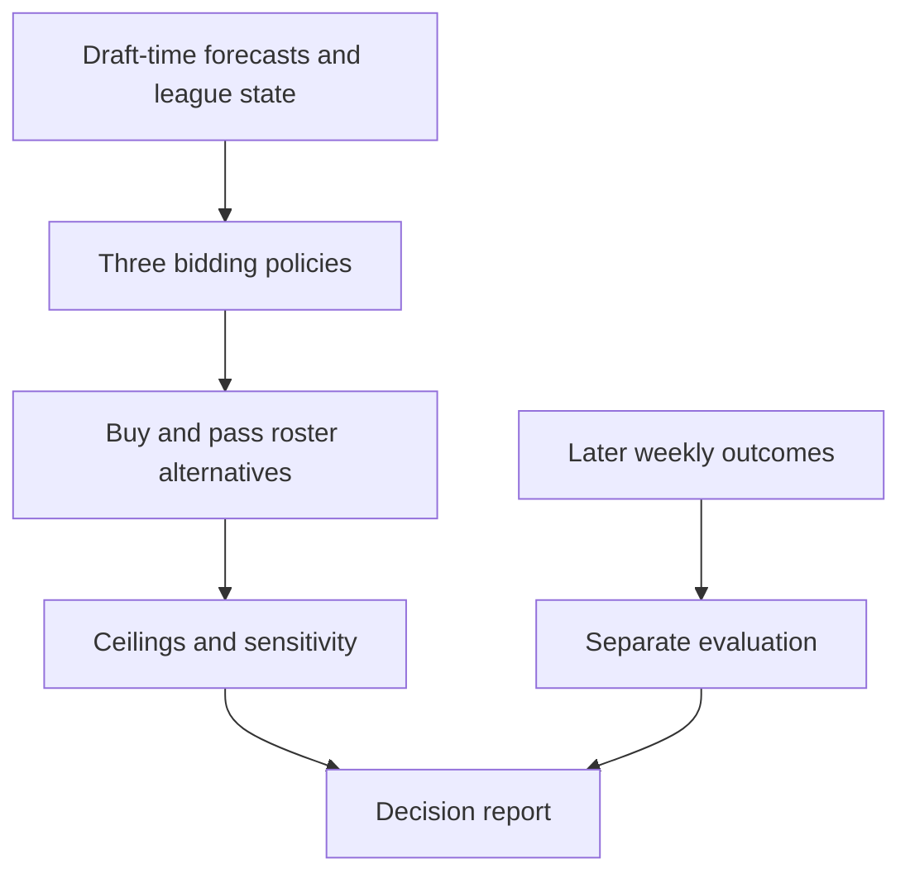
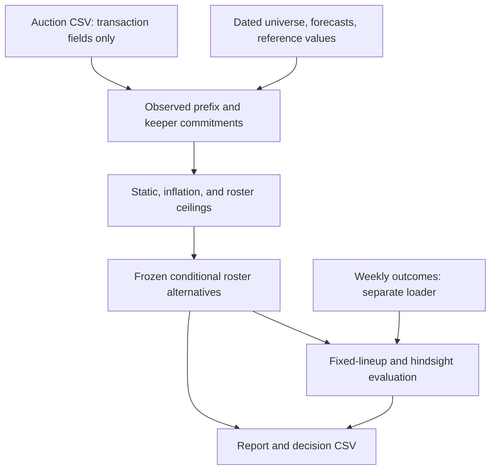
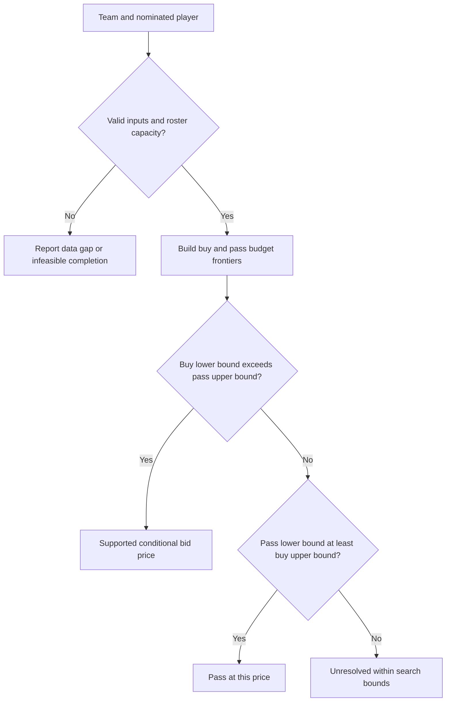
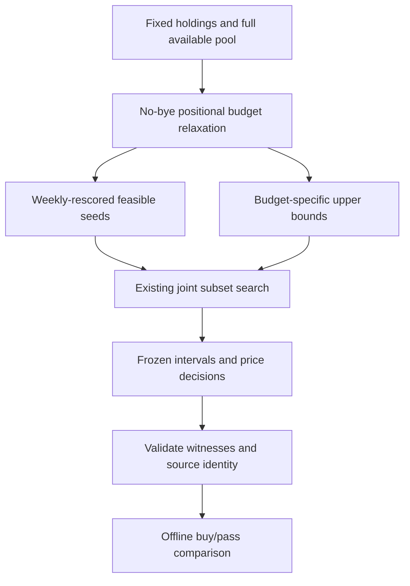

# League-specific auction replay - Plan

## Goal Capsule

- **Objective:** Help Bo determine when paying more for a player improves the roster his league's auction budget can buy.
- **Means:** Replay the 2025 Discount Double Check auction with complete buy/pass rosters and bounded weekly scoring (KTD3, KTD6).
- **Product authority:** Bo approved investigating league-relative premiums through his historical draft. This plan owns that first valuation benchmark.
- **Authority:** Product requirements govern behavior; technical decisions govern their implementation. The current increment strengthens joint starter/bench search, compares matched historical alternatives, and shows validated bounds in the local companion.
- **Stop conditions:** Surface source-access failures, missing scoring coverage, or unresolved search bounds per R3 and R9. They block affected conclusions, not independent calculation checks.
- **Tail ownership:** Bo authorizes the current scoped implementation, commits, push, and pull request. Include existing source dependencies needed to reproduce this increment. Bo owns merging and separately authorizes provider mutations or deployment.

---

## Product Contract

### Summary

Build a reproducible local auction replay that compares three valuation policies across the 2025 league. Explain justified premiums through the roster alternatives available at each decision and report how those conclusions change when future prices or player performance differ.

### Problem Frame

Waiting for individual bargains can leave scarce starting positions underpowered while the remaining budget competes for weaker substitutes. Bo's four purchases of Ridley, Odunze, Hunter, and Jeudy cost $53; Puka Nacua sold earlier for $49. Their later production motivates investigation, but cannot tell us the premium a manager should have paid before the season.

The existing research covers all 196 draft selections, including 14 keepers. Its points include Week 18 and ignore weekly lineup selection. They are descriptive evidence, not a replay result.

### Key Decisions

- **Complete league-relative roster comparison is the core.** Governs R4, R5. (session-settled: user-directed; chosen over making static fair prices or roster displays the primary product: Bo needs the relative value of paying versus passing.)
- **Historical decision replay is the first milestone.** Governs R1, R2, R6. (session-settled: user-approved; chosen over drawing strategy conclusions from season totals alone: Bo approved the proposed replay after the limits of hindsight comparisons were explained.)
- **Use the simplest local analytical deliverable.** Governs R7. This is an implementation assumption for the first benchmark, with the broader shared application retained as context.

### Requirements

**Historical evidence**

- R1. Reconstruct the actual 2025 auction for all 14 teams from its rules, keepers, budgets, and observed sale sequence.
- R2. Every recommendation must use only information available at that decision, with the source date and uncertainty visible.
- R3. Reject missing, ambiguous, or incompatible inputs that would change a conclusion instead of silently treating them as zero or inventing certainty.

**Valuation and alternatives**

- R4. Compare a reference-price policy, a league-inflation policy, and a roster-aware policy under the same information and feasible budget constraints.
- R5. Explain each roster-aware bid ceiling through the projected starting-lineup benefit and cost of the best modeled buy-versus-pass alternatives.
- R6. Evaluate recommendations across all eligible decision moments and vary future prices and forecast assumptions, keeping retrospective season outcomes separate from recommendation inputs.

**Deliverable and interpretation**

- R7. Produce a local, reproducible decision report and machine-readable results that Bo can inspect.
- R8. Evaluate realized roster production through Weeks 1–17 using a stated legal-lineup method, with optimistic hindsight lineup scores clearly labeled.
- R9. Distinguish exploratory evidence from demonstrated generalization; insufficient data or no improvement must remain reportable outcomes.
- R10. Preserve the cost of completing a usable roster, including keeper commitments, vacant starting positions, and bench slots.

### Key Flow

- F1. Review a historical decision.
  - **Trigger:** Bo requests the league replay.
  - **Steps:** Validate sources and league state; calculate comparable ceilings; inspect buy/pass roster alternatives; evaluate sensitivity and later production.
  - **Outcome:** Bo can explain why a premium is supported, unsupported, or unresolved.
  - **Covered by:** R1–R10.

### Acceptance Examples

- AE1. A keeper listed at the end of Yahoo's draft table is already owned before the first auction sale; the replay deducts the salary and removes that player from available alternatives. **Covers R1, R10.**
- AE2. A forecast updated after the draft cannot drive a historical recommendation; an unknown publication date produces a visible data limitation. **Covers R2, R3.**
- AE3. A star above the reference value receives a higher ceiling only while the modeled feasible roster after buying beats the pass alternative; raising the price enough removes that advantage. **Covers R4, R5.**
- AE4. Changing a player's realized 2025 points cannot change the bid ceiling calculated before the season. **Covers R2, R6.**
- AE5. A proposed purchase that leaves insufficient money or positions to complete the roster is rejected even when that player has the highest projection. Bo's historical roster with no kicker remains faithfully recorded. **Covers R1, R10.**
- AE6. If future-price assumptions reverse the preference, the report shows the reversal rather than calling the premium reliable. **Covers R6, R9.**
- AE7. Week 18 cannot improve the reported fantasy-season outcome, and selecting weekly starters using realized points is labeled an optimistic hindsight score. **Covers R8.**
- AE8. Unmatched players or missing weekly observations are surfaced with their affected decisions; a partial report does not appear to be a completed league benchmark. **Covers R3, R7, R9.**

### Success Criteria

A cold reader can reproduce a recommendation and its limiting assumptions. The benchmark can support or reject the premium hypothesis without selecting favorable players after seeing the results. No percentage improvement or winning claim is assumed in advance.

<!-- ce-section: work-relationships -->
### How This Work Fits Together

This plan owns the historical valuation benchmark. The following relationships describe the current understanding, not a committed roadmap.

- **Enables** a Yahoo draft companion by establishing what its valuation engine must calculate.
- Yahoo account connection and live draft access **can proceed independently of** model evaluation once their own scope is settled.
- Private coaching for friends **depends on** account isolation and league access; its recommendations **share** the valuation engine.
- ESPN coverage and monetization are **still to decide** after useful valuation and source permissions are established.

### Scope Boundaries

- Deferred to follow-up work: hosted application, login/OAuth, live auction synchronization, automated bidding, friend onboarding, ESPN, and billing.
- Manager-specific behavioral models wait for enough earlier history to test them; this benchmark may use pooled room behavior.
- Championship probability and causal claims about how the actual auction would have unfolded are outside this benchmark.

### Dependencies and Assumptions

- The original tool Bo followed in 2025 is not yet identified. A dated public reference may support an exploratory baseline, but cannot stand in for a measured recreation of that tool.
- A single observed auction does not establish other managers' maximum bids.
- A separate season may be recoverable through Yahoo's history. Its availability and suitability remain research questions, not a promised validation result.

### Sources and Research

- [Concept](../concept.md).
- [2025 auction analysis](../research/2025-discount-double-check-analysis.md), with Yahoo source links and collection limitations.
- [196-player dataset](../research/2025-discount-double-check-auction.csv).
- [Existing calculation checks](../../src/auction_replay/analyze_2025_draft.py).
- [Ideation comparison](../ideation/2026-09-05-yahoo-auction-assistant-ideation.html).

---

## Planning Contract

**Product Contract preservation:** R1–R10, F1, AE1–AE8, and U1–U4 keep their meaning and IDs. The current software increment advances U3–U4 while preserving the U1–U2 input and state contracts. Missing data or unresolved bounds remain reportable under R3 and R9.

### Current evidence and increment

The existing `completion_frontier` already searches complete rosters jointly. Its cheap seed and relaxed ownership of every remaining player can leave weak incumbents and wide intervals. The [bench coverage study](../research/2025-bench-coverage-study.md) changes 30 of 82 central-price rankings, but protects the starting core and proves no optimal ceilings. Strengthen the shared complete-roster search rather than turn that study's local repairs into a new optimizer.

The [historical price pilot](../research/2025-historical-price-pilot.md) covers 95 eligible Bo nominations and reconciles 173 offensive totals. Its simplified scoring omits components and K/DEF production; its 2026 retrieval hashes do not prove that displayed 2025 forecasts were historically immutable. Retain those limitations. The current increment can finish with validated software, a reproducible partial comparison, and an honest companion even while the full-scoring league benchmark remains incomplete.

### Key Technical Decisions

- KTD1. **Keep the benchmark in Python with local files.** Extend the existing research modules using the standard library, integer auction dollars, and Decimal scoring. Reuse their assertion-based checks and the existing offline HTML companion. Preserve the original descriptive script; no solver dependency, service, database, or application framework is needed for R7.

- KTD2. **Separate auction facts, forecasts, and outcomes at ingestion.** The policy loader accepts only auction fields from the existing CSV and never calls the outcome-checking `read_rows()`. Provider IDs remain strings; fantasy-team label `n/a` is a real team. A source manifest records URL, publisher date, retrieval time, content hash, scoring coverage, identity mappings, and permitted local use. The dated preseason universe must include undrafted alternatives. This enforces R1–R3 and AE4 without letting a season-point checksum become a hidden dependency of recommendations.

- KTD3. **Freeze the observed prefix before each nomination.** Initialize all keepers before sale 1, then process the 182 non-keeper sales. A policy sees earlier completed sales but neither the current closing price nor later prices/owners. It produces a conditional ceiling for every team with an open roster spot. Apply the observed sale only after all recommendations for that moment are frozen. Hypothetical buy/pass completions are independent branches; neither rewrites the historical timeline. This implements R1, R2, R6.

- KTD4. **Use explicit, comparable reference policies.** First rebase the dated source values to this league's $2,800 budget and 196 roster places, distributing discretionary dollars in proportion to source value above $1. The initial reference pool includes every keeper and fills remaining places by source value, with starter-position coverage and stable-ID ties. The static policy freezes those rebased values before keeper deductions. The inflation policy rescales remaining excess reference dollars to remaining discretionary league dollars after keeper commitments and earlier sales. Refresh its reference pool to match the number of unfilled roster places, excluding owned players and preserving feasible starter coverage. Round displayed ceilings down and cap them by legal purchasing capacity. A zero discretionary denominator produces a $1-only estimate with a warning. All policies share the same universe, state, forecast horizon, feasibility check, and hypothetical completion evaluator. Raw source prices remain contextual, and none of these baselines represents Draft Sharks or FantasyPros performance. Governs R4; the roster policy adds the mechanism in KTD6.

- KTD5. **Model future prices without seeing future sales.** Use the inflation-policy estimate as the initial market estimate. A pooled adjustment uses only prior non-keeper sales: shrink their median actual-to-predicted price ratio toward 1 with weight n/(n+20), where n is the prior-sale count. Use the estimate made before each past sale in that ratio. Apply predeclared future-price multipliers 0.8, 1.0, and 1.2, rounded up to whole dollars with a $1 floor. These are stress scenarios, not probabilities or recovered opponent maximum bids. Do not fit manager-specific models to this season. Governs R2, R6.

- KTD6. **Strengthen complete-roster frontiers with a valid relaxation.** Keep `completion_frontier` and its deterministic subset search. Only observed holdings and the buy nominee are fixed; every other starter or bench player can change. Remove the nominee from future availability in both branches. Maximize projected Weeks 1–17 starting-lineup production across all 14 paid roster places, with legal starter coverage. Bench players score only when selected into a weekly starting slot. Governs R4, R5, R10.

  Extract the positional `(count, cost)` dynamic program from `historical_price_pilot.season_frontier` into `replay_auction.py`; the pilot already imports this module. Preserve its raw scoring numerator and roster witness before its historical 16/17 conversion. For each root completion budget `b`, let `M[b]` be the exact maximum no-bye starter projection sum with zero bench credit over complete feasible rosters. Convert integer millionths to projection units exactly before using `M`. With `H` evaluated weeks, `H * M[b] / 17` bounds weekly production above: each weekly lineup's projection sum is at most the best no-bye lineup score on the same roster. Intersect this budget-specific root bound with existing node bounds, including all pending nodes at cutoff. Never derive this bound by rescaling the pilot's rounded output or by adding backup credits.

  Rescore each distinct dynamic-program roster with the real bye/absence objective and record it as a feasible lower bound at every affordable budget. Preserve the pilot's existing backup-credit and scaling behavior in its wrapper. For helper inputs outside its supported one-FLEX and six-decimal domain, keep the existing valid general search and record the fallback; do not reject valid replay inputs or round them into the helper's domain.

  Keep fixed, recorded limits identical for equivalent branches. Count and cap relaxation transitions separately from search nodes; if the relaxation stops early, discard its partial optimum as an upper bound and retain the prior valid search bound. Retain any independently validated feasible seeds. A cutoff never proves infeasibility. Preserve the full `_compare_frontiers` truth table: support buying when buy lower bound exceeds pass upper bound, and pass when pass lower bound is at least buy upper bound. A proven infeasible pass branch with a feasible buy supports buying; a proven infeasible buy with a pass incumbent supports passing; two proven infeasible branches report infeasible. Missing incumbents never imply infeasibility, and comparisons not resolved by these rules remain unresolved. Equality favors passing.

- KTD7. **Expose performance assumptions instead of inventing probabilities.** With only season projections, allocate forecast production uniformly across the NFL team's scheduled games, then restrict the objective to Weeks 1–17. Value bench coverage through scheduled byes. Add named sensitivity cases that reduce a prospective purchase's forecast by 20% and remove it for two predeclared non-bye weeks. Do not call these calibrated injury distributions or double-adjust availability without disclosing it. Show the neutral ceiling and the range across stress cases. Governs R5, R6, R9.

- KTD8. **Keep historical scoring separate from recommendation quality.** Freeze completed roster alternatives before loading outcomes. Evaluate each using a fixed preseason projection ordering, known bye schedule, and deterministic slot assignment; no hindsight injury substitutions or invented waiver acquisitions. Also show the best legal weekly lineup over that same roster as an optimistic bound. Never sum overlapping decision branches into a simulated team season or treat them as independent samples. The current no-kicker roster remains incomplete, with its missing slot reported; the evaluator must not invent a purchase, refund, or free replacement. Governs R6, R8–R10.

- KTD9. **Compare matched historical alternatives before claiming improvement.** Add a joint-weekly mode to the existing pilot while retaining its labeled fixed-starter comparator. Freeze the eligible nomination set, scenario grid, objective, and work limits before evaluating outcomes. Each policy uses the same observed prefix, complete candidate universe, future prices, budget, and lineup evaluator. Report paired deltas on identical cases; show unmatched cases and reasons separately. Use matched forecast-covered outcome components as the primary exploratory comparison, with full-offensive outcomes labeled as sensitivity. This does not populate accepted full-scoring engine inputs or establish prospective validation. Governs R2, R4, R6, R8, R9.

  Select the earliest, middle, and latest nominations from the forecast-only eligible Bo sequence, across the three KTD5 price factors and KTD7 neutral, forecast, and explicit two-absence cases. The primary comparison uses the legal whole-dollar grid; actual closing-price probes remain secondary descriptive analysis. Measure total time including preprocessing, work counts, witness legality, interval widths, and decision counts. Run the remaining eligible nominations when practical; account for all 182 sales, including the existing exclusions and any unrun cases. An unrun case is not a negative or unresolved search result. Persist the selection and run parameters so an interrupted comparison can be reproduced without selecting favorable outcomes. Evaluation consumes explicit per-price statuses; it must not turn unresolved prices into passes by comparing them with one ceiling.

- KTD10. **Display the frozen proof state in the existing companion.** Extend the snapshot and builder to carry decimal lower/upper bounds, feasible witnesses, supported and possible ceilings, objective identity, sensitivity, and search effort. Bind it to auction/source hashes plus every code and objective input that affects recommendations. Reject stale or incompatible snapshots with a regeneration instruction. Validate finite bounds, status/null consistency, roster membership, mandatory holdings, completion cost, starter coverage, and the independently recomputed weekly witness score before publishing local HTML. Recompute ceilings and price verdicts from the validated rows using KTD6; serialize those per-price decisions so browser floating-point rounding is display-only. Witness validation proves the lower bound's feasibility; the U3 mathematical checks establish the upper-bound method. Show best-found buy/pass rosters with their intervals, and withhold a precise ceiling where proof is unresolved. Preserve previous output on validation failure. Governs R3, R5–R7, R9, R10.

  Keep probe snapshots separate from the companion input. A companion snapshot accounts for every sale and requested scenario: unrun or excluded nominations show a reason, and evaluated nominations contain the complete legal-price grid for each declared case. Never replace a complete snapshot with a truncated probe. Display the objective and snapshot identity, and expose the three price and three performance cases with their KTD7 range. The scenario identity includes forecast factor, explicit absent weeks, price factor, horizon, roster rules, and work limits. Keep factual cash capacity visible when positional completion blocks a nomination, without inventing model decisions for it.

  Keep the current future-price selector and add a labeled native performance-assumption selector, defaulted to neutral. Beside the verdict, always show the neutral supported and possible ceilings, their ranges across performance cases at the selected future prices, and a notice when the nine-case grid disagrees. Label absent support as “No supported bid”; do not turn a possible ceiling into a precise recommendation. Preserve this summary while changing the selected case.

  Render the following states from the frozen decision and branch records. Before each render, clear the previous verdict, intervals, rosters, and costs; populate only fields present in the selected records. When a witness exists, show its roster and completion cost and label its score “Best found” unless optimality is proved. Show branch bounds as an interval; equal proved bounds may show one score. A proved-infeasible branch always says “No feasible completion” with no score, roster, or cost, including when the other branch remains unresolved.

  | State | Verdict | Branch content | Ceiling summary and reason |
  |---|---|---|---|
  | Both branches exact | Buy or pass at this price, marked exact | Both proved scores, rosters, and costs | Show the case ceiling bounds; collapse only if they agree. |
  | Supported buy | Buy supported at this price | Available witnesses and intervals; mark the pass branch infeasible only if proved | Show both ceiling bounds and the proof reason. |
  | Supported pass | Pass supported at this price | Available witnesses and intervals; mark the buy branch infeasible only if proved | Show both ceiling bounds and the proof reason. |
  | Unresolved, both witnesses | Unresolved at this price | Both best-found rosters, costs, and intervals | Show supported/possible bounds and why they overlap. |
  | Unresolved, missing witness | Unresolved at this price | For a finite upper bound without a witness, say “No feasible roster found within the work limit” and show only that bound | Show supported/possible bounds and the missing-witness reason. |
  | Both branches proved infeasible | No feasible completion at this price | No rosters or scores; mark both branches infeasible | Retain the case summary if other prices exist; explain the feasibility failure. |
  | Unrun | Not evaluated | No model branch content | No model ceilings; show why this nomination was not run. |
  | Excluded | Recommendation unavailable | No model branch content | No model ceilings; show the source or completion constraint. |

### High-Level Technical Design

The data boundary implements KTD2, KTD3, and KTD8:

The decision boundary implements KTD6:

Budget feasibility uses remaining dollars minus $1 for every other unfilled roster place. Positional completion is a separate check: a historically legal purchase can still leave no path to a usable full lineup. Such states remain in coverage counts under R3 and R10.

The optimizer and companion share one proof path (KTD6, KTD10):

### Assumptions

These are agent-selected defaults for the first benchmark, not user-confirmed preferences:

- The local report is enough to assess valuation before choosing an application stack.
- Fixed rosters and the lineup rule in KTD8 isolate draft decisions; this understates benefits from active waiver management and may penalize injuries.
- KTD5 and KTD7 stress cases explore plausible changes without claiming their probabilities.
- One-season results are exploratory. A later season held out after model choices are frozen is needed for prospective validation; already examined 2025 outcomes cannot become an untouched test set.
- The first benchmark can report no supported premium. A weak or unresolved result does not justify adding a fixed superstar multiplier.

### Research update: Gemini strategy brief

Bo supplied the brief on September 5, 2026. Treat it as candidate strategy and architecture research, not approval to expand U1–U4. R1–R10 and AE1–AE8 retain their scope.

- **Preserve conditional premiums.** The proposed 115%–135% prices, 60%–75% concentration, and 70%–80% waiver replacement production are unvalidated for this league. They may motivate future experiments, but do not become defaults or win-rate claims. The first replay explicitly excludes waiver acquisitions and championship probability, so it cannot settle those claims.
- **Compare against credible alternatives.** The cited [Fantasy Football Analytics optimizer](https://fantasyfootballanalytics.net/2013/06/win-your-fantasy-football-auction-draft.html) already describes league-specific starting-lineup optimization. Its linked [auction strategy study](https://harvardsportsanalysis.files.wordpress.com/2012/04/fantasyfootballdraftanalysis1.pdf) reports conditional simulations and notes that results depend on rival strategies. Neither establishes a universal failure of VBD or guaranteed superiority of stars-and-scrubs.
- **Keep inflation internally consistent.** KTD4 and the implementation already compare discretionary cash with reference value above the $1 minimum, using a pool sized to remaining roster places with starter coverage. Dividing that cash by full sticker prices, or by an unrelated starters-only pool, mixes incompatible totals. Exclude stranded cash on full rosters. Inflation remains a market baseline; KTD6 determines whether a price improves the modeled roster.
- **Distinguish capacity from value.** Under the modeled $1 minimum, legal capacity is remaining budget minus `(open slots - 1)`. Outbidding every eligible rival may secure one player, but does not establish a good purchase or control over later auctions. Never use an inferred lack of positional need as proof an opponent cannot bid.
- **Keep tactical claims conditional.** Early nominations and price enforcement change rivals' actions. The frozen observed-prefix replay cannot prove their causal effects. A future experiment must permit failed nominations and unwanted wins, and compare concentrated and balanced policies under the same information and opponent assumptions.

The [Yahoo integration findings](../research/2026-09-05-yahoo-integration-feasibility.md) record the corresponding platform checks and proposed live-companion follow-up.

### Data Sources and Execution-Time Validation

The following findings change input selection. They are not claims that the files have already been imported.

| Input | Evidence or candidate | Consequence |
|---|---|---|
| Actual draft | Existing 196-row CSV and recorded Yahoo settings | Preserve source picks and separate the 14 keepers; collect the complete scoring coefficients before rescaling outside statistics. |
| Public reference prices | [FFToday 2025 half-PPR values](https://www.fftoday.com/rankings/25_av_half_ppr.html), displayed 8/24/25 | Candidate reference for KTD4; its 12-team, 18-slot format differs from this league. |
| Preseason forecasts | [FFToday 2025 QB projections](https://www.fftoday.com/rankings/playerproj.php?LeagueID=1_1&PosID=10&Season=2025&cur_page=1&order_by=RuTD&sort_order=DESC), displayed 8/31/25 | Validate every position and page. Historical navigation can omit the season parameter and return 2026. |
| Excluded forecast version | [ESPN 2025 projection guide](https://g.espncdn.com/s/ffldraftkit/25/NFLDK2025_CS_ClayProjections2025.pdf), displayed updated 9/4/25 | Exclude this version from draft-time inputs because the draft was 9/3/25. |
| Weekly actual statistics | [nflreadr player stats](https://nflreadr.nflverse.com/reference/load_player_stats.html) and its linked dictionary | Candidate CSV source, with exact league scoring reconciliation; team DEF needs separate coverage. |
| Original advice | Bo's original 2025 tool and saved sheet remain unidentified | Do not label a public reference baseline as a replay of the tool he used. |
| Additional league history | Yahoo's observed 2024 history entry | Candidate earlier market-calibration source; retrieval and coverage are not established. |

A publisher's displayed date is weaker evidence than a preserved pre-draft copy. Record that difference. Current retrieval hashes establish reproducibility from now onward, not historical immutability. Unknown or later dates cannot enter recommendations under R2.

Full Yahoo scoring includes fields such as kicker field-goal yardage and lost fumbles. Check source coverage by position; do not substitute default platform fantasy points. Missing scoring components require a visible approximation sensitivity or block affected conclusions under R3.

Use bounded read-only collection and cached local inputs. Keep credentials out of files. Provider-derived raw data goes in ignored `data/local/`; update `.gitignore` for that exact directory. Public availability or a code license does not establish commercial data-redistribution rights. No provider contact or paid source purchase is part of this plan.

### Risks and Dependencies

- Incomplete historical forecasts or identity coverage can prevent a real-data result. U1 must identify the affected players, fields, and source needed; the synthetic calculation proof can continue.
- Winning salaries do not reveal losing bids or manager response. KTD3 and KTD5 keep counterfactual claims conditional.
- Search cost may limit full-league coverage. KTD6 exposes bounds and unresolved decisions; increase the work limit only after measuring the bottleneck.
- The future player pool may include a named player absent from the source. Exclude the unsupported conclusion, not the player silently; do not shrink the universe to the eventual draftees.
- The existing analysis is a research snapshot. The new report supersedes neither the historical raw CSV nor Yahoo's actual league records.

### Deferred execution questions

- **Runtime and interval usefulness:** Measure KTD9 probes before spending on the full grid. If seeds remain weak, a bounded deterministic one-player swap search may improve lower bounds by replacing any nonfixed player. Keep it optional, preserve the full search, and do not change the historical bench study's protected-core meaning. Tighter per-week relaxations wait for measured need.
- **Historical input coverage:** U1 continues to report exact missing components and identities. Candidate-cache comparisons remain exploratory; a software pull request does not require unavailable full-scoring inputs or a positive strategy result.
- **2026 settings and opposing keepers:** Verify the signed-in league read-only when browser access permits, alongside historical work. Record unresolved scoring or keeper facts and keep the preparation view non-actionable until its own inputs are verified. Live sync, provider writes, and current-season recommendations remain outside this increment.

---

## Implementation Units

### U1. Validate and separate the historical inputs

- **Goal:** Supply reproducible inputs with enough provenance to distinguish usable evidence from gaps.
- **Requirements:** R1–R3, R7, R8; F1; AE2, AE4, AE8.
- **Dependencies:** None.
- **Files:** `src/auction_replay/replay_auction.py`, `tests/test_replay_auction.py`, `.gitignore`, and ignored manifests and source tables under `data/local/2025/`. Read the existing auction CSV and analysis without changing them.
- **Approach:** Preserve the existing KTD1–KTD2 input validation and source separation. Refresh coverage evidence for the available pilot inputs, and keep the accepted full-scoring loader closed when those inputs do not meet its contract. Use explicit errors at input boundaries rather than assertions.
- **Patterns to follow:** CSV and Decimal usage in `src/auction_replay/analyze_2025_draft.py`; preserve string IDs and absent fields.
- **Test scenarios:**
  - Covers AE2. A wrong-year page or post-draft timestamp is rejected as a forecast input.
  - Covers AE4. Removing or changing realized-points columns leaves policy input identical.
  - Covers AE8. An ambiguous name, missing scoring field, duplicate identity, or absent weekly row produces a named coverage gap.
  - Numeric Yahoo IDs, defense slugs, and team `n/a` retain their distinct meanings.
- **Verification:** The input report reconciles the existing 196 draft rows, records source coverage, and states which downstream calculations are enabled. Data gaps remain explicit blockers to real-data conclusions.

### U2. Reconstruct auction state and baseline ceilings

- **Goal:** Reproduce the room at each decision and calculate comparable static and inflation ceilings.
- **Requirements:** R1–R4, R10; F1; AE1, AE5.
- **Dependencies:** U1; synthetic inputs can establish mechanics before all real data is available.
- **Files:** `src/auction_replay/replay_auction.py`, `tests/test_replay_auction.py`.
- **Approach:** Reuse KTD3–KTD5 and the existing budget/position checks as the shared state boundary for the joint pilot and companion.
- **Patterns to follow:** Existing keeper boolean and integer-dollar conventions.
- **Test scenarios:**
  - Covers AE1. All 14 keepers are unavailable before sale 1 and their costs reduce manager budgets.
  - Changing the current or later sale price cannot change an earlier ceiling; changing an earlier sale can affect the next estimate.
  - A zero inflation denominator, no prior sales, full roster, and insufficient reserve produce defined results.
  - Covers AE5. Bo's final no-kicker state is preserved and reported as unable to complete the modeled lineup.
- **Verification:** The observed timeline reconciles $2,774 spend, $231 keeper cost, and each team's original holdings. Both baselines agree on legal purchasing capacity.

### U3. Calculate conditional roster premiums

- **Goal:** Show where buying a nominee beats the best modeled pass alternative.
- **Requirements:** R4–R6, R10; F1; AE3, AE5, AE6.
- **Dependencies:** U2.
- **Files:** `src/auction_replay/replay_auction.py`, `tests/test_replay_auction.py`, `src/auction_replay/historical_price_pilot.py`, and `tests/test_historical_price_pilot.py`.
- **Approach:** Implement KTD6–KTD7 at the shared completion boundary. Extract the raw positional helper once, preserve the pilot wrapper's old objective, then seed and tighten the existing joint search. Keep proof metadata separate from displayed scores.
- **Execution note:** Establish the relaxation and cutoff invariants with the existing independent exhaustive oracle before real-pool measurements.
- **Patterns to follow:** `season_frontier` positional tables and dominance pruning; `oracle_score` and `oracle_frontier` exhaustive enumeration; existing Decimal comparisons and stable ID ties.
- **Test scenarios:**
  - Covers AE3. A small case supports a premium until a known whole-dollar breakpoint; both frontiers match exhaustive enumeration.
  - Passing excludes the nominee, flex uses each player once, and byes change backup usefulness.
  - Covers AE5. Buying a high-projection player cannot consume reserved money or make required positions impossible.
  - Covers AE6. Raising future alternative prices changes the ceiling; lowering the candidate projection can reverse it.
  - A search limit returns valid bounds and an unresolved comparison instead of a false precise recommendation.
  - Across every budget and several cutoffs, independent enumeration satisfies lower bound ≤ optimum ≤ upper bound; completed searches match the oracle. A genuinely proved infeasible result is allowed even at one node.
  - A tiny fixture requires replacing a starting-core player to improve bye coverage; joint search can find it, and a 16/17 fixed-starter score cannot be mistaken for its weekly upper bound.
  - Mandatory zero-cost holdings, paid K/DEF slots, nonpositive forecasts, multiple FLEX slots, and forecasts beyond six decimals retain correct feasible bounds; unsupported helper shapes use the recorded fallback.
  - A relaxation cutoff retains pending-search coverage. Reordered candidates and equal scores produce deterministic witnesses; the old pilot's neutral and backup-credit outputs remain unchanged.
- **Verification:** All oracle inequalities and witness checks hold. Every supported price has KTD6 proof. KTD9 probe results quantify runtime and interval usefulness without promising a particular rate of resolved prices.

### U4. Produce the league decision benchmark

- **Goal:** Make the recommendation differences and their limits inspectable.
- **Requirements:** R2, R5–R9; F1; AE4, AE6–AE8.
- **Dependencies:** U1–U3.
- **Files:** `src/auction_replay/historical_price_pilot.py`, `tests/test_historical_price_pilot.py`, `src/auction_replay/build_draft_companion.py`, `templates/draft-companion.html`, `tests/test_draft_companion.py`, and `README.md`. Preserve the engine/report contracts in `src/auction_replay/replay_auction.py` and `tests/test_replay_auction.py`. Write the new summary to `docs/research/2025-joint-roster-pilot.md` and frozen results under ignored `data/local/2025/joint-roster-pilot/`; generated companion HTML stays under ignored `data/local/companion/`.
- **Approach:**
  1. Add the KTD9 matched joint mode and frozen schema to the existing pilot, using KTD8 outcome separation. Keep the old historical reports intact as labeled evidence.
  2. Add KTD10 bound validation and per-price decisions to the builder and existing buy/pass view. Preserve the 182-sale timeline, hypothetical-state reset, and source limitations.
  3. Make the core calculation and snapshot checks runnable with synthetic inputs without private cache access. Keep a separate explicit local-cache integration check, and document the actual coverage and regeneration paths.
- **Patterns to follow:** The existing pilot recommendation/evaluation boundary, companion `compact_bound` validation, safe JSON embedding, and temporary-file replacement.
- **Test scenarios:**
  - Covers AE4. Permuting realized outcomes changes evaluation but leaves recommendations byte-identical.
  - Covers AE7. Adding Week 18 cannot change the Weeks 1–17 score; hindsight lineup scores cannot be mislabeled as preselected lineups.
  - Covers AE8. Missing actuals do not become zero; verified nonparticipation can.
  - Covers AE6. Scenario disagreement stays visible in both report and CSV, and overlapping branches are not added into a fictitious season.
  - Re-running identical inputs and search limits yields identical substantive results and hashes.
  - A snapshot with an invalid upper/lower order, wrong sensitivity score, missing mandatory player, unaffordable cost, or changed recommendation code hash is rejected without replacing the previous HTML.
  - A valid unresolved bound without an incumbent renders without an invented roster or score. Exact ties favor passing; rounding cannot change a serialized decision.
  - Proven infeasible buy/pass combinations and near-equal Decimal scores preserve Python/browser verdict parity at every legal integer bid. Duplicate or missing declared scenarios fail validation; a probe snapshot cannot replace the companion snapshot.
  - Matched-policy comparisons exclude unmatched cases with reasons; unrun nominations and missing outcomes remain visible in coverage totals. Current/later sale changes do not alter frozen earlier recommendations.
  - Browser checks exercise a supported price, overlapping intervals, an absent incumbent, a price-scenario reversal, and an excluded nomination using the same Python proof decisions.
- **Verification:** Bo can trace a displayed decision to validated bounds and sources. The matched report gives disposition counts and paired outcomes for the measured subset; all remaining nominations have explicit exclusions or unrun status. The full engine retains full team/nomination coverage accounting without calling the pilot a completed full-scoring benchmark.

---

## Verification Contract

- **Calculation checks:** `python3 -B tests/test_replay_auction.py` and `python3 -B tests/test_historical_price_pilot.py` cover U1–U3 with independent small-pool oracles and leakage checks. Required portable checks must not depend on ignored provider cache; preserve the existing curated auction CSV dependency where the historical state audit uses it.
- **Companion check:** `python3 -B tests/test_draft_companion.py` covers U4 snapshot validation and browser calculations using synthetic inputs. Run the explicit private-cache integration path when those sources are available and report that evidence separately. Node.js is already used for browser-calculation checks; add no test framework.
- **Existing evidence audit:** `PYTHONPATH=src python3 -B -m auction_replay.analyze_2025_draft` remains the descriptive snapshot check, separate from recommendations.
- **Real-data check:** The benchmark run must record source hashes, year/date checks, join coverage, scoring reconciliation, search bounds, and all decision disposition counts.
- **Interpretation check:** Apply R8–R9 before presenting findings. A missing source or unresolved search can yield a partial report, but cannot pass as full benchmark completion.
- **Review:** Independent review of calculation logic and the report's claims is required before sharing results beyond this local project. There is no application build, deployment, or `release:validate` command in this repository.
- **Publication boundary:** Include the necessary existing replay, pilot, companion, test, and curated historical-state dependencies in the scoped pull request. Keep provider snapshots, account receipts, audit JSON, browser probes, and generated private HTML out of Git. Verify repository visibility and the published commit; do not infer data-redistribution permission from repository privacy.

---

## Definition of Done

- **Current software increment:** U3's strengthened bounds pass the independent oracle and compatibility checks; U4 produces a reproducible matched report and a companion that displays only validated proof states. U1–U2 source and state protections remain intact.
- Every measured case names its inputs, objective, work limits, disposition, and witness evidence. The historical pilot accounts for all 182 sales, including exclusions and unrun cases; it does not silently stand in for full-league coverage.
- R1–R10 and AE1–AE8 remain the benchmark contract. Synthetic checks demonstrate calculation behavior, while the report states which real-data examples remain blocked.
- **Full historical benchmark:** Completion additionally requires accepted full-scoring inputs and the full team/nomination disposition report and CSV. If prerequisites or runtime prevent this, name the exact remaining gap and leave this milestone incomplete; the software increment can still be reviewed and shipped.
- Positive results are labeled exploratory until evaluated on data not used to choose the model.
- Remove abandoned experimental code and temporary debug output. Preserve the original evidence and keep private source snapshots ignored.
